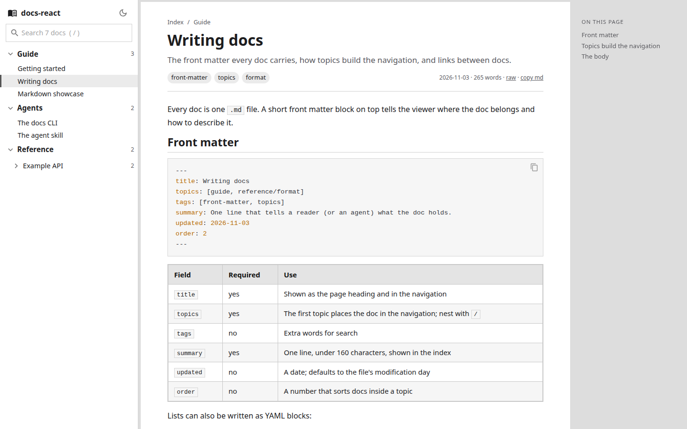
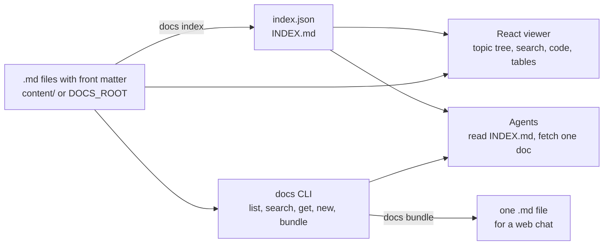
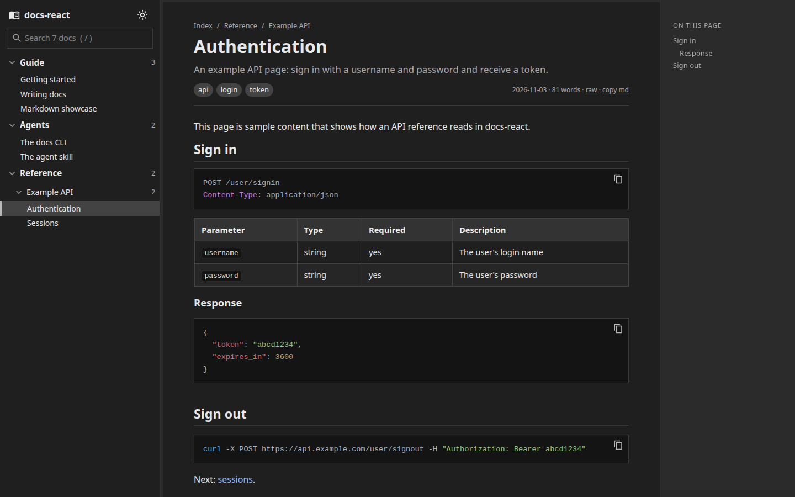

<h1 align="center">docs-react</h1>

<p align="center">
  <strong>Markdown documentation viewer and agent CLI. Drop <code>.md</code> files with front matter in a folder and get topic navigation, search, syntax-highlighted code, tables and dark and light themes, plus an index and a <code>docs</code> command that coding agents use to read, write and bundle the same docs.</strong>
</p>

<p align="center">
  
  
  
  
  
  
  
</p>

<p align="center">
  <a href="https://hec-ovi.github.io/docs-react/">Live demo</a> ·
  <a href="#quick-start">Quick start</a> ·
  <a href="#the-doc-format">Doc format</a> ·
  <a href="#the-docs-cli">CLI</a> ·
  <a href="#agent-skill">Agent skill</a>
</p>

<p align="center">
  
</p>

---

## What it does

docs-react keeps documentation as plain Markdown files that people read in a fast React viewer and agents read from the shell. One folder, two readers:



| Feature | Detail |
|---|---|
| Markdown first | GitHub-flavoured Markdown: tables, task lists, strikethrough, fenced code |
| Topic navigation | The first topic in each doc's front matter places it in a nested tree (`reference/api`) |
| Search | Instant filter over titles, summaries, tags and topics in the viewer; full-text search in the CLI |
| Code | Prism highlighting for 16 languages, loaded only when a page has code, with a copy button |
| Index for agents | `INDEX.md`: one line per doc (title, path, topics, summary) that any agent can read |
| Bundles | `docs bundle` joins whole topics into one Markdown file with a table of contents |
| Themes | Dark and light, following the system until you pick one |
| Private by default | The `content/` folder is ignored by git; the public demo builds from `example/` only |
| Fast | One small JSON index on load, each doc fetched on demand and cached, Markdown and highlighter in lazy chunks |

<p align="center">
  
</p>

## Quick start

```bash
git clone https://github.com/hec-ovi/docs-react.git && cd docs-react
npm install
npm run dev                      # http://localhost:5173/ with the example library
```

Use your own library: put Markdown files in `content/` (ignored by git), or point `DOCS_ROOT` at any folder.

```bash
mkdir content && node bin/docs.mjs new guide "Hello" --summary "My first doc."
npm run dev                      # now shows content/
DOCS_ROOT=/srv/team-docs npm run dev
```

| Command | Output |
|---|---|
| `npm run dev` | Dev server; reindexes and reloads when a doc changes |
| `npm run build` | `dist/` with the library copied to `dist/content/` |
| `npm run build:pages` | `docs/` for GitHub Pages, built from `example/` only |
| `npm run docs -- <command>` | The CLI without installing it |

The viewer resolves the library in this order: `DOCS_ROOT` (environment or `.env`), `content/` when it exists, `example/`.

## The doc format

```markdown
---
title: Writing docs
topics: [guide, reference/format]
tags: [front-matter, topics]
summary: One line that tells a reader or an agent what the doc holds.
updated: 2026-11-03
order: 2
---

A short lead paragraph, then sections.

## First section
```

| Field | Required | Use |
|---|---|---|
| `title` | yes | Page heading and navigation label (falls back to the first `#` heading) |
| `topics` | yes | First topic places the doc in the navigation; nest with `/`; the rest feed lists, search and bundles |
| `tags` | no | Extra search words |
| `summary` | yes | One line, shown in the index and in `INDEX.md` |
| `updated` | no | A date; defaults to the file's modification day |
| `order` | no | Sorts docs inside a topic |

Relative links between docs (`[sessions](sessions.md)`) and relative images work in the viewer and on GitHub alike. An optional `docs.config.json` at the library root sets the title, the order of top-level topics and display labels:

```json
{ "title": "Team docs", "topicOrder": ["guide", "agents", "reference"], "topicLabels": { "reference/api": "API" } }
```

## The docs CLI

Node 18 or newer, standard library only. Plain-text output sized for agents; errors print `error:` and a `hint:`.

| Command | What it does |
|---|---|
| `docs info` | Library folder, doc, topic and word counts, index age |
| `docs list [topic] [--json]` | One line per doc: id, title, topics, summary |
| `docs topics` | Every topic with its doc count |
| `docs search <words...>` | Docs holding all the words, ranked, with the matching line |
| `docs get <id\|path\|slug>` | Print a doc (`--body` drops the front matter) |
| `docs new <topic> <title>` | Create a doc with front matter (`--tags`, `--summary`, `--stdin` for the body) |
| `docs index` | Rebuild `index.json` and `INDEX.md`; warn about missing fields, broken links, emails and home-directory paths |
| `docs bundle <topic\|id...> -o out.md` | Join topics into one Markdown file and print its size in words and tokens |

```text
$ docs list guide
guide/getting-started · Getting started · [guide] · Install, run the viewer, and point it at your own folder of Markdown docs.
guide/writing-docs · Writing docs · [guide] · The front matter every doc carries, how topics build the navigation, and links between docs.

$ docs bundle guide agents -o guide.md
guide.md · 5 docs · 1270 words · about 2k tokens
```

## Agent skill

`skills/docs-react/SKILL.md` follows the open Agent Skills format and works in Claude Code, Codex, Gemini CLI, Grok and OpenCode. It tells an agent to read `INDEX.md` or `docs list` before opening anything, to search before writing, to create docs with `docs new`, and to run `docs index` after edits.

```bash
./install.sh               # docs CLI in ~/.local/bin, skill links in ~/.claude, ~/.agents and ~/.gemini
./install.sh --project .   # skill links for one project only
./install.sh --dry-run     # show the actions
./install.sh --uninstall
```

The installer only creates symlinks to the checkout and never replaces an existing file. Claude Code users can also add the repository as a plugin marketplace (`.claude-plugin/marketplace.json`); Codex gets a `/docs` command from `plugins/docs-react-codex`. After editing the skill, `npm run sync:skill` refreshes the copies in `SKILL.md` and `plugins/`.

## Project layout

```text
bin/docs.mjs               the CLI
lib/library.mjs            scan, index, lint (shared by the CLI and the Vite plugin)
lib/frontmatter.mjs        front matter parser and slugs (shared with the viewer)
src/                       the React viewer (Material UI, react-markdown, remark-gfm, Prism)
vite.config.js             serves the library at ./content/, reindexes on change, copies it into builds
example/                   the public sample library behind the live demo
skills/docs-react/         the agent skill; plugins/ and SKILL.md hold synced copies
content/                   your private library (ignored by git)
docs/                      the GitHub Pages build
```

## License

[MIT](LICENSE) for the code in this repository. Third-party libraries (React, Vite, Material UI, react-markdown, remark-gfm, react-syntax-highlighter) keep their own licenses. The sample docs under `example/` are illustrative.
